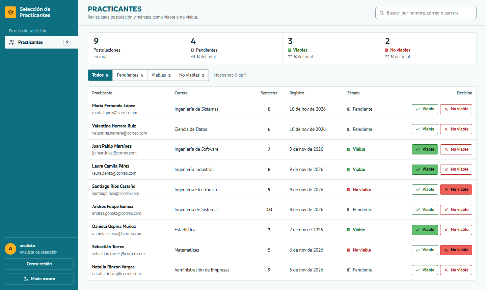
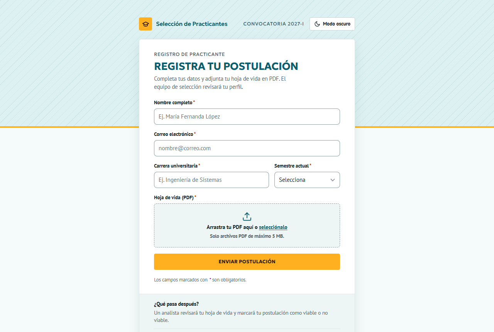
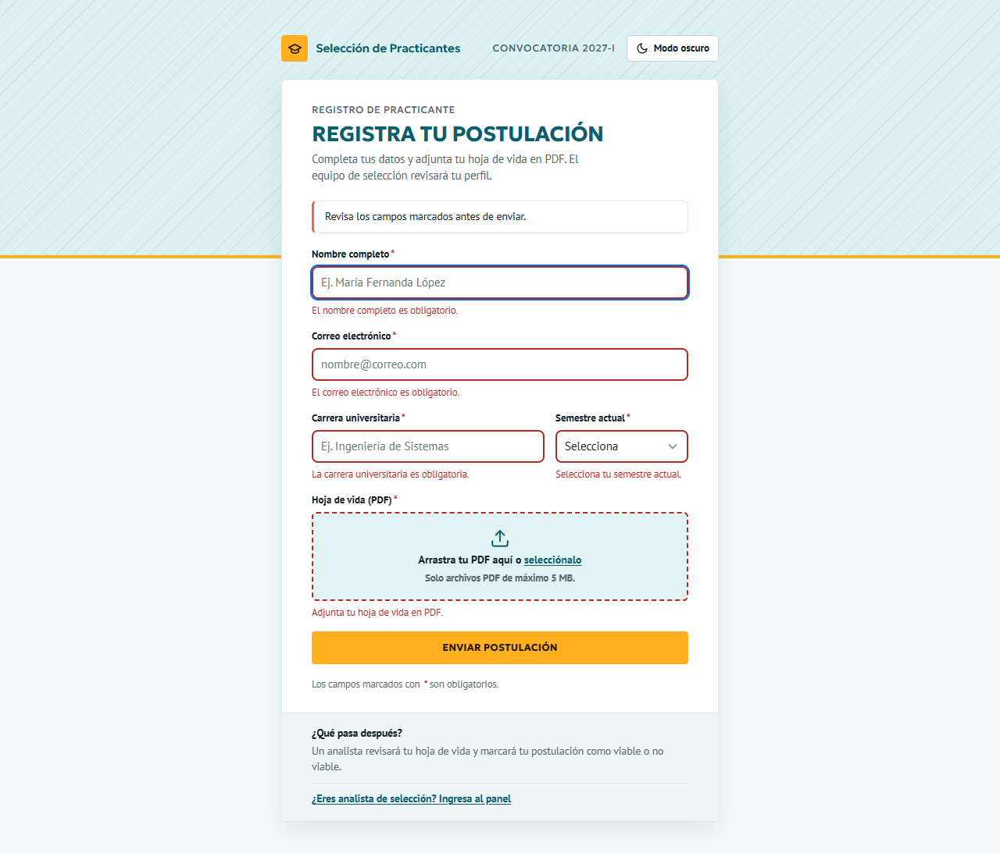
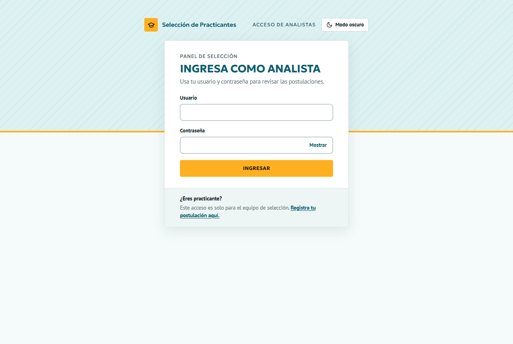
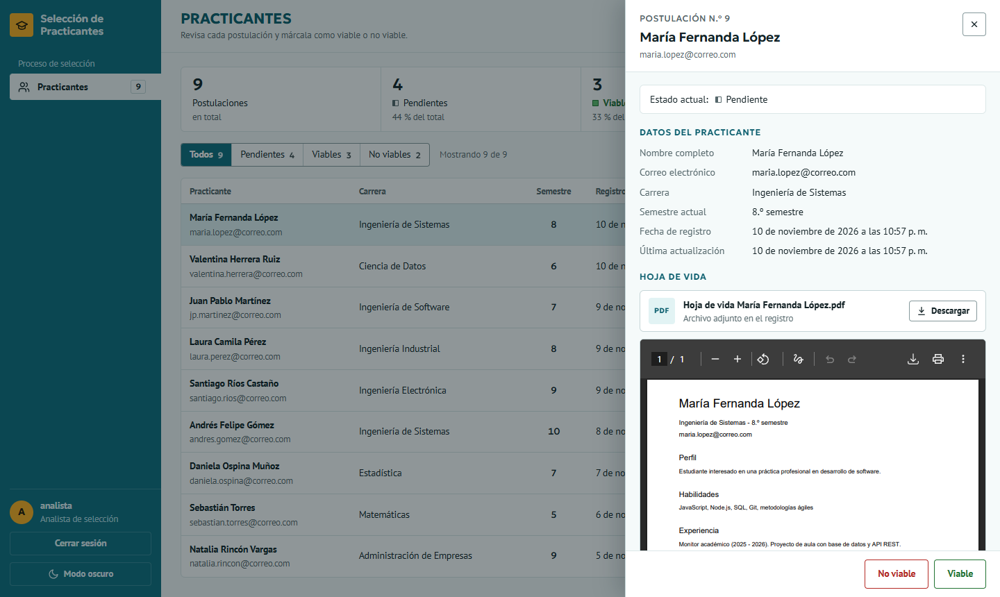
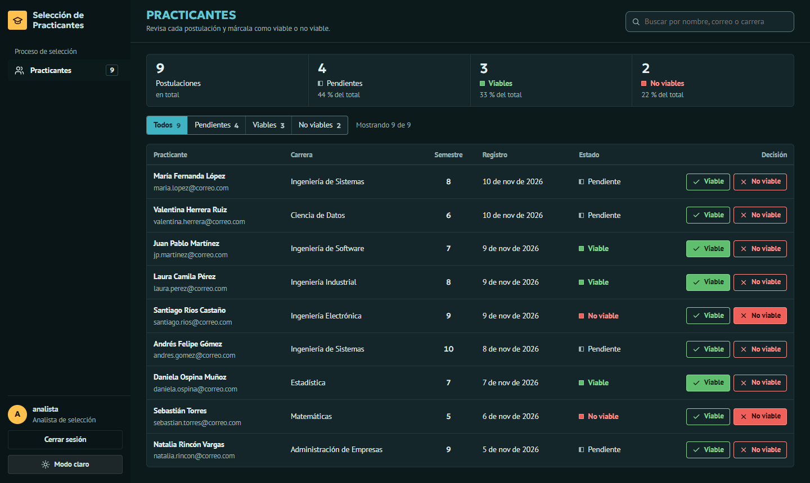
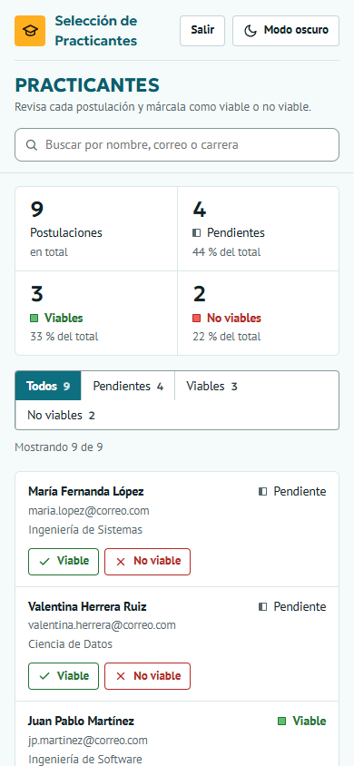

# Plataforma de Selección de Practicantes

Reto técnico **Practicante FullStack 2027-I**. Es una herramienta web donde los practicantes registran sus datos y su hoja de vida, y los analistas de selección revisan cada postulación y la marcan como **viable** o **no viable**.



## Contenido

- [Funcionalidades](#funcionalidades)
- [Tecnologías](#tecnologías)
- [Instalación y ejecución](#instalación-y-ejecución)
- [Pruebas](#pruebas)
- [Capturas](#capturas)
- [API](#api)
- [Seguridad](#seguridad)
- [Estructura del proyecto](#estructura-del-proyecto)
- [Decisiones de diseño](#decisiones-de-diseño)

## Funcionalidades

**Requisitos del reto**

- [x] Formulario de registro con nombre completo, correo, carrera, semestre y hoja de vida en PDF
- [x] Validación de campos obligatorios en el navegador **y** en el servidor
- [x] Panel del analista: lista de practicantes, detalle de cada uno y botones **Viable** / **No viable**
- [x] API para guardar, consultar y actualizar el estado de los practicantes
- [x] Base de datos local SQLite
- [x] Hojas de vida guardadas en una carpeta del servidor (`uploads/`)

**Desafíos opcionales**

- [x] **Autenticación básica**: solo los analistas con usuario y contraseña acceden al panel y a la API
- [x] **Descarga de archivos**: el analista ve la hoja de vida dentro del panel y la descarga con su nombre original

**Extras**

- Resumen por estado, filtros, búsqueda que ignora tildes y opción de **deshacer** cada decisión
- Validación del PDF por su contenido (firma `%PDF-`) y no solo por la extensión
- Modo claro y oscuro, diseño adaptado a celular y navegación completa con teclado
- 77 pruebas automáticas y un script de datos de ejemplo

## Tecnologías

| Capa | Herramienta |
|---|---|
| Back-end | Node.js 22+ y Express 5 |
| Base de datos | SQLite incluido en Node.js (`node:sqlite`), sin dependencias nativas que compilar |
| Archivos | Multer, con el PDF guardado en `uploads/` |
| Autenticación | bcryptjs + sesiones propias en SQLite con cookie `HttpOnly` |
| Front-end | HTML, CSS y JavaScript, sin frameworks |
| Pruebas | Jest y Supertest |

## Instalación y ejecución

**Requisito:** [Node.js](https://nodejs.org/) **22.13 o superior** (probado con Node 24). No hace falta instalar nada más: la base de datos SQLite viene incluida en Node.

```bash
# 1. Clonar el repositorio
git clone https://github.com/CarlZeichenfolge/plataforma-seleccion-practicantes.git
cd plataforma-seleccion-practicantes

# 2. Instalar dependencias
npm install

# 3. (Opcional) Cargar 9 practicantes de ejemplo con sus hojas de vida
npm run seed

# 4. Iniciar el servidor
npm start
```

Luego abre:

| Página | URL |
|---|---|
| Formulario para practicantes | http://localhost:3000 |
| Panel del analista | http://localhost:3000/panel.html |

**Credenciales del analista (por defecto):**

| Usuario | Contraseña |
|---|---|
| `analista` | `Analista123*` |

### Configuración (opcional)

Sin configurar nada, el proyecto funciona con valores por defecto. Para cambiarlos, copia `.env.example` como `.env` y edítalo:

| Variable | Por defecto | Para qué sirve |
|---|---|---|
| `PORT` | `3000` | Puerto del servidor |
| `ADMIN_USER` / `ADMIN_PASSWORD` | `analista` / `Analista123*` | Analista que se crea la primera vez que arranca el servidor |
| `DB_PATH` | `data/practicantes.db` | Archivo de la base de datos |
| `UPLOAD_DIR` | `uploads` | Carpeta donde se guardan las hojas de vida |
| `MAX_FILE_MB` | `5` | Tamaño máximo del PDF |

> El analista se crea solo si todavía no existe. Para cambiar su contraseña después, borra `data/practicantes.db` o usa otro `ADMIN_USER`.

Otros comandos:

```bash
npm run dev                 # inicia el servidor y lo reinicia al guardar cambios
npm run seed -- --limpiar   # borra todos los practicantes y vuelve a cargar los ejemplos
```

## Pruebas

```bash
npm test
```

Son 77 pruebas en 4 archivos de `tests/`. Cada uno usa una base de datos en memoria y una carpeta temporal, así que no tocan los datos reales.

| Archivo | Qué revisa |
|---|---|
| `validacion.test.js` | Reglas de cada campo y detección de PDF real |
| `registro.test.js` | Registro: PDF falso, tamaño máximo, correo duplicado, nombres de archivo maliciosos |
| `auth.test.js` | Rutas protegidas, cookie segura, contraseña cifrada, bloqueo por intentos fallidos, cierre de sesión |
| `practicantes.test.js` | Listar, filtrar, detalle, cambio de estado, ver y descargar la hoja de vida |

## Capturas

| Formulario de registro | Validación de campos |
|---|---|
|  |  |

| Ingreso de analistas | Detalle con la hoja de vida |
|---|---|
|  |  |

| Modo oscuro | Celular |
|---|---|
|  |  |

## API

Todas las respuestas son JSON, salvo la hoja de vida, que se entrega como PDF.

| Método | Ruta | Acceso | Descripción |
|---|---|---|---|
| `POST` | `/api/practicantes` | Público | Registra un practicante (`multipart/form-data` con `nombre`, `correo`, `carrera`, `semestre`, `hojaVida`) |
| `GET` | `/api/practicantes` | Analista | Lista los practicantes. Filtro opcional: `?estado=pendiente\|viable\|no_viable` |
| `GET` | `/api/practicantes/:id` | Analista | Detalle de un practicante |
| `PATCH` | `/api/practicantes/:id/estado` | Analista | Cambia el estado. Cuerpo: `{ "estado": "viable" }` |
| `GET` | `/api/practicantes/:id/hoja-de-vida` | Analista | Ver el PDF. Con `?descargar=1` lo descarga |
| `POST` | `/api/auth/login` | Público | Inicia sesión. Cuerpo: `{ "usuario", "password" }` |
| `POST` | `/api/auth/logout` | Analista | Cierra la sesión |
| `GET` | `/api/auth/sesion` | Público | Indica si hay una sesión activa |

**Códigos de respuesta:** `201` creado · `400` datos inválidos (con un mensaje por campo en `detalles`) · `401` sin sesión · `404` no existe · `409` correo ya registrado · `413` archivo muy grande · `429` demasiados intentos de inicio de sesión.

## Seguridad

- **La validación se hace en el navegador y en el servidor.** La del navegador ayuda al usuario; la del servidor es la que protege, porque la otra se puede saltar.
- **El PDF se revisa por su contenido.** Un archivo renombrado a `.pdf` se rechaza. Se guarda con un nombre UUID, nunca con el original, para evitar sobrescrituras y *path traversal*.
- **Se protege la API, no solo la página.** Sin sesión, las consultas de practicantes responden `401` y `/panel.html` redirige al login.
- **Las contraseñas se guardan con bcrypt** (costo 12).
- **Las sesiones van en una cookie `HttpOnly` y `SameSite=Strict`**, que JavaScript no puede leer y que otros sitios no pueden usar. En la base de datos solo se guarda el hash SHA-256 del token, y la sesión dura 8 horas.
- **El inicio de sesión no revela qué usuarios existen:** el mensaje y el tiempo de respuesta son iguales en los dos casos. Tras 5 intentos fallidos, el acceso se bloquea 15 minutos.
- **Las consultas SQL usan parámetros**, lo que protege contra inyección SQL. **Todo el contenido se inserta con `textContent`**, lo que protege contra XSS.
- **Las hojas de vida y la base de datos no se suben al repositorio** (`.gitignore`), porque contienen datos personales.

## Estructura del proyecto

```
├── public/                  Front-end (archivos estáticos)
│   ├── index.html           Formulario de registro
│   ├── login.html           Ingreso de analistas
│   ├── panel.html           Panel del analista
│   ├── css/styles.css       Sistema visual compartido
│   └── js/                  registro.js, login.js, panel.js, tema.js
├── src/                     Back-end
│   ├── server.js            Punto de entrada
│   ├── app.js               Configuración de Express y rutas
│   ├── config.js            Variables de entorno
│   ├── db.js                Conexión y esquema de SQLite
│   ├── routes/              Endpoints de practicantes y autenticación
│   ├── repositories/        Consultas SQL (únicos archivos que tocan la base de datos)
│   ├── services/            Lógica de autenticación
│   ├── middlewares/         Subida de archivos, sesión, límite de intentos y errores
│   └── validators/          Validación del registro
├── scripts/seed.js          Datos de ejemplo
├── tests/                   Pruebas automáticas
├── data/                    Base de datos (no se versiona)
└── uploads/                 Hojas de vida (no se versionan)
```

## Decisiones de diseño

- **Node + Express y front sin framework.** El reto pide HTML, CSS y JavaScript para el front, y para una herramienta de este tamaño un framework sumaba complejidad sin aportar valor.
- **La app está separada del servidor** (`app.js` y `server.js`) y recibe la base de datos como parámetro. Por eso las pruebas corren contra una base en memoria sin abrir puertos.
- **Paleta "Océano y ámbar".** El verde azulado de la marca transmite confianza y crecimiento; el ámbar se reserva para el botón principal (regla 60-30-10). Verde y rojo solo indican viable y no viable, y cada estado se reconoce también por su forma y su texto, no solo por el color.
- **Deshacer en vez de confirmar.** Marcar a un practicante es reversible, así que en lugar de pedir confirmación en cada clic se ofrece **Deshacer** durante unos segundos.

---

Desarrollado por **Carlos Alejandro Cadena**.
